# 🌟 Awesome AI SDKs & APIs 🚀

### A Curated Directory of Frontier AI Provider SDKs, Multi-Model Gateways, Local Inference Engines & Autonomous Agent Orchestration Frameworks

  
  
  
  
  
  

---

**Discover the best AI developer tooling**: From enterprise LLM APIs with exact token pricing to self-hosted open-source gateways, autonomous agent engines, and high-performance inference servers.

## 📑 Table of Contents

- [📊 Sector Overview & Market Dynamics](#-sector-overview--market-dynamics)
- [☁️ SaaS / Hosted LLM API Platforms](#️-saas--hosted-llm-api-platforms)
- [🔓 Open-Source GitHub Projects (Ranked by ⭐ Stars)](#-open-source-github-projects-ranked-by--stars)
- [🛠️ Recommended Architecture Combinations](#️-recommended-architecture-combinations)
- [📈 Star History](#-star-history)
- [💖 Support & Community](#-support--community)
- [🤝 How to Contribute](#-how-to-contribute)
- [⚖️ Disclaimer & Standards](#️-disclaimer--standards)

---

## 📊 Sector Overview & Market Dynamics

The global **AI API & Inference market** is estimated at **$44B–$65B in 2025** and projected to surge past **$83B–$85B by 2026**, expanding at a **~30–32% CAGR** as enterprise generative AI workloads transition from experimental testing to production-scale inference and agentic pipelines. 

The sector exhibits **moderate concentration**:
- An oligopoly of mega-cap hyperscalers (**Microsoft Azure, Alphabet Google Cloud, Amazon AWS**) and frontier model labs (**OpenAI, Anthropic**) commands the overwhelming share of enterprise inference volume and closed-weight frontier capabilities.
- Simultaneously, a highly dynamic and fragmented ecosystem has emerged around **open-source inference serving (Ollama, vLLM)**, **universal model routing gateways (LiteLLM, Portkey)**, and **multi-agent orchestration frameworks (LangChain, Dify, CrewAI, LlamaIndex)** to prevent vendor lock-in and optimize operational latency and costs.

---

## ☁️ SaaS / Hosted LLM API Platforms

Comprehensive breakdown of leading hosted AI model APIs, sorted in descending order by parent company valuation / enterprise scale:

| Company / Product | Description & Capabilities | Company Size (Valuation / Revenue) | Starting Tier Pricing | Free Tier / Trial Limits |
| :--- | :--- | :--- | :--- | :--- |
| **[Azure OpenAI Service](https://azure.microsoft.com/en-us/products/ai-services/openai-service)** | Microsoft's enterprise-managed OpenAI models with security, enterprise compliance, virtual networks, and regional data residency. Accessible via REST APIs and the OpenAI SDK. | **Microsoft**: ~$3.1T Market Cap / $245B+ Annual Revenue | **$0.150 / 1M input tokens** & **$0.600 / 1M output tokens** (GPT-4o-mini standard pay-as-you-go) | **$200 credit** (valid 30 days on Azure Free Trial; requires upgrading subscription to Pay-As-You-Go with $0 spend to unlock 0 TPM default LLM quota limits) |
| **[AWS Bedrock](https://aws.amazon.com/bedrock/)** | Fully managed foundation model service offering Anthropic Claude, Amazon Nova/Titan, Meta Llama, Mistral, and Cohere with automated guardrails, RAG knowledge bases, and multi-agent routing. | **Amazon**: ~$2.2T Market Cap / $620B+ Annual Revenue | **$0.06 / 1M input tokens** & **$0.24 / 1M output tokens** (Amazon Nova Micro on-demand) | **$100–$200 AWS Promotional Credits** (valid 30 days to 6 months upon account activation/onboarding prompt tasks; no perpetual free tier) |
| **[Google Gemini API](https://ai.google.dev/)** | Official API for Gemini models via Google AI Studio and Vertex AI. Supported by the unified `google-genai` SDK and Google Agent Development Kit (ADK) across Python, JS/TS, Go, and Java. | **Alphabet**: ~$2.1T Market Cap / $350B+ Annual Revenue | **$0.075 / 1M input tokens** & **$0.30 / 1M output tokens** (Gemini 2.5 Flash / 1.5 Flash paid tier up to 128k prompt context) | **Free Forever Tier**: 15 RPM (requests/min), 1,000,000 TPM (tokens/min), and 1,500 RPD (requests/day) on Gemini Flash models in Google AI Studio |
| **[OpenAI API](https://platform.openai.com/)** | Industry-standard API powering GPT-4o, GPT-4o-mini, o-series reasoning models, DALL-E, Whisper, and Embeddings. Supported by OpenAI Agents SDK with native MCP and guardrails. | **OpenAI**: ~$157B Valuation (Oct 2024 funding round) / ~$3.7B–$5B Annualized Revenue | **$0.150 / 1M input tokens** & **$0.600 / 1M output tokens** (GPT-4o-mini pay-as-you-go; minimum $5 initial balance deposit) | **Pay-as-you-go only (0 automatic free signup credits)**; requires $5 minimum deposit (Free testing tier available via Researcher Grants up to $1,000 or opt-in training data sharing allocations) |
| **[Anthropic API](https://www.anthropic.com/api)** | Official API for Claude 3.5/3.7 models (Haiku, Sonnet, Opus). Powers the Claude Agent SDK with built-in sub-agent tools, tool call interception hooks, and first-class Model Context Protocol (MCP) support. | **Anthropic**: ~$60B Valuation (early 2025 / late 2024 funding) / ~$1B+ Annualized Revenue | **$0.80 / 1M input tokens** & **$4.00 / 1M output tokens** (Claude 3.5 Haiku pay-as-you-go) | **$5 one-time free credit** upon phone verification in Anthropic Console (expires upon balance depletion; no perpetual free tier) |
| **[Mistral AI Platform](https://mistral.ai/)** | Official API (La Plateforme) for European frontier open-weight models including Mistral Large, Mistral Small, Codestral, and Pixtral with Apache-2.0 or commercial license endpoints. | **Mistral AI**: ~$6.2B Valuation / ~$30M+ Annualized Revenue | **$0.10 / 1M input tokens** & **$0.30 / 1M output tokens** (Mistral Small / Codestral serverless pay-as-you-go) | **Free Mode (Experimental Tier)**: Free API access with no credit card required, rate-limited to 1 RPS (request/sec) for personal experimentation and prototyping |
| **[Cohere Platform](https://cohere.com/)** | Enterprise-focused API platform for Command R+, Command R, Embed v3, and Rerank v3 models. Supports private cloud, on-premises, and VPC enterprise deployments. | **Cohere**: ~$5.5B Valuation / ~$35M+ Annualized Revenue | **$0.15 / 1M input tokens** & **$0.60 / 1M output tokens** (Command R fine-tuned/production pay-as-you-go; Embed from $0.10 / 1M tokens) | **Free Trial Key (Free Forever for Dev)**: Up to 1,000 API calls per month, rate-limited to 20 RPM (Chat) and 5 RPM (Embed) for non-commercial prototyping |

---

## 🔓 Open-Source GitHub Projects (Ranked by ⭐ Stars)

Curated list of the top open-source AI SDKs, gateways, local runtimes, and agent frameworks, **sorted in descending order by GitHub star count**. Each repository badge links directly to its live stargazers page:

1. **[Ollama](https://github.com/ollama/ollama)**   
   **Get up and running with Llama 3, Mistral, Gemma, and other open LLMs locally** (MIT). Provides a lightweight OpenAI-compatible REST API server and cross-platform CLI for macOS, Windows, and Linux. The most popular tool for local AI development.

2. **[Dify](https://github.com/langgenius/dify)**   
   **Production-grade open-source LLM app development platform** (Apache-2.0). Combines AI workflow orchestration, RAG pipelines, agent capabilities, model management, and full observability into an intuitive UI and comprehensive backend SDK/API.

3. **[LangChain](https://github.com/langchain-ai/langchain)**   
   **The universal framework for building context-aware reasoning applications** (MIT). Compose agent loops from models, tools, prompts, and middleware. Integrates with **LangGraph** for resilient cyclic graph workflows with checkpointing, time-travel debugging, and multi-actor execution.

4. **[vLLM](https://github.com/vllm-project/vllm)**   
   **High-throughput and memory-efficient LLM serving engine** (Apache-2.0). Pioneered PagedAttention for KV-cache optimization. Delivers state-of-the-art serving throughput with continuous batching and drop-in OpenAI-compatible API endpoints.

5. **[LiteLLM](https://github.com/BerriAI/litellm)**   
   **The fastest, litest multi-LLM gateway and proxy** (MIT). Call 100+ LLMs (Bedrock, Azure, OpenAI, Anthropic, Vertex AI, vLLM, Groq, Cohere) using the unified OpenAI API format with built-in load balancing, fallbacks, budget tracking, and guardrails.

6. **[CrewAI](https://github.com/crewAIInc/crewAI)**   
   **Cutting-edge framework for orchestrating role-playing autonomous AI agents** (MIT). Enables collaborative multi-agent intelligence where specialized autonomous agents share tasks, tools, and execution contexts seamlessly.

7. **[LlamaIndex](https://github.com/run-llama/llama_index)**   
   **The premier data framework for production RAG systems** (MIT). Offers 500+ data connectors via LlamaHub, advanced chunking and indexing algorithms (vector, graph, hybrid), reranking pipelines, and LlamaParse for complex tabular documents and PDFs.

8. **[OpenAI Python SDK](https://github.com/openai/openai-python)**   
   **The official Python client library for the OpenAI API** (Apache-2.0). Features auto-generated strict typings, robust streaming helpers, async client support, and native integration with the OpenAI Agents SDK.

9. **[Microsoft Semantic Kernel](https://github.com/microsoft/semantic-kernel)**   
   **Enterprise SDK for integrating LLMs into idiomatic code** (MIT). Available for C#, Python, and Java. Provides enterprise-ready plugins, planners, persona definitions, and vector store connectors.

10. **[Vercel AI SDK](https://github.com/vercel/ai)**   
    **The standard TypeScript toolkit for building modern AI applications** (Apache-2.0). Features unified primitives (`generateText`, `streamText`, `generateObject`, `streamObject`) across 25+ providers with native V8 Edge compatibility and React Server Components hooks.

11. **[Haystack by deepset](https://github.com/deepset-ai/haystack)**   
    **Production-ready LLM orchestration framework** (Apache-2.0). Emphasizes typed pipelines for semantic search, QA, and RAG systems with modular nodes, enterprise observability, and rigorous evaluation tooling.

12. **[Guidance](https://github.com/guidance-ai/guidance)**   
    **A guidance language for controlling large language models** (Apache-2.0). Interleaves generation, prompting, and constrained regex/CFG parsing directly into the token sampling loop for blazing fast structured outputs.

13. **[Outlines](https://github.com/dottxt-ai/outlines)**   
    **Structured text generation with guaranteed JSON schemas and regular expressions** (Apache-2.0). Implements finite state machines over token vocabularies for 100% syntactically valid JSON and regex-constrained completions.

14. **[Portkey AI Gateway](https://github.com/Portkey-AI/gateway)**   
    **Ultra-fast AI gateway with 250+ model integrations and 45+ guardrails** (Apache-2.0). Written in TypeScript; features sub-millisecond overhead, automatic retries, semantic caching, and fallbacks.

15. **[OpenAI Node.js SDK](https://github.com/openai/openai-node)**   
    **The official TypeScript / Node.js library for the OpenAI API** (Apache-2.0). Built with complete TypeScript definitions and zero heavy external runtime dependencies.

16. **[AWS Boto3 SDK](https://github.com/boto/boto3)**   
    **Official AWS SDK for Python** (Apache-2.0). Provides complete programmatic access to the Amazon Bedrock runtime, Knowledge Bases, Guardrails, and Agents.

17. **[RouteLLM](https://github.com/lm-sys/RouteLLM)**   
    **Open-source cost-optimizing LLM router** (Apache-2.0). Dynamically routes prompts between cheaper models and flagship models, preserving ~95% of GPT-4 benchmark quality at 85%+ lower cost.

18. **[Google Gen AI Python SDK](https://github.com/googleapis/python-genai)**   
    **Official Google Gen AI SDK for Python** (Apache-2.0). Replaces deprecated libraries to provide standard access to Gemini 2.5/1.5, Imagen, Veo, and the Live Multimodal API.

19. **[Anthropic Python SDK](https://github.com/anthropics/anthropic-sdk-python)**   
    **Official Python library for Anthropic Claude** (MIT). Delivers typed message APIs, structured tool definitions, streaming events, and native OpenTelemetry distributed tracing.

20. **[OpenAI OpenAPI Specification](https://github.com/openai/openai-openapi)**   
    **The authoritative OpenAPI specification for the OpenAI ecosystem** (MIT). Powers automatic code generation of client SDKs, mock servers, and gateway proxies worldwide.

21. **[Anthropic TypeScript SDK](https://github.com/anthropics/anthropic-sdk-typescript)**   
    **Official TypeScript library for the Claude API** (MIT). Supports Node.js, Cloudflare Workers, Deno, and V8 Edge environments with full SSE streaming support.

22. **[Google Gen AI JavaScript/TypeScript SDK](https://github.com/googleapis/js-genai)**   
    **Official Google Gen AI JavaScript/TypeScript SDK** (Apache-2.0). First-class Gemini API client library for frontend, Node.js, and serverless runtimes.

23. **[Mistral Python Client](https://github.com/mistralai/client-python)**   
    **Official Python client for Mistral AI** (Apache-2.0). Connects with La Plateforme for Mistral Large, Codestral, and Pixtral endpoints.

24. **[Cohere Python SDK](https://github.com/cohere-ai/cohere-python)**   
    **Official Python SDK for the Cohere Platform** (MIT). High-level bindings for Command R/R+, Embed v3, and the industry-standard Cohere Rerank API.

---

## 🛠️ Recommended Architecture Combinations

To architect a resilient, cost-effective, and vendor-neutral AI system, consider combining these specialized layers:

- **⚡ Unified Multi-Model Gateway**: Deploy **[LiteLLM](https://github.com/BerriAI/litellm)** or **[Portkey Gateway](https://github.com/Portkey-AI/gateway)** at your infrastructure perimeter for automatic fallbacks, token budget tracking, semantic caching, and unified OpenAI format compatibility.
- **🖥️ Local High-Speed Inference**: Utilize **[vLLM](https://github.com/vllm-project/vllm)** for production GPU clustering and **[Ollama](https://github.com/ollama/ollama)** for local developer sandboxes.
- **🌐 Web & TypeScript Applications**: Integrate **[Vercel AI SDK](https://github.com/vercel/ai)** for streaming text, structured object generation, and seamless Next.js / React Server Components edge compatibility.
- **📚 Production RAG Pipelines**: Use **[LlamaIndex](https://github.com/run-llama/llama_index)** for multi-modal ingestion, indexing, and reranking, or **[Haystack](https://github.com/deepset-ai/haystack)** for deterministic typed pipelines.
- **🤖 Autonomous Multi-Agent Teams**: Combine **[LangGraph](https://github.com/langchain-ai/langchain)** or **[CrewAI](https://github.com/crewAIInc/crewAI)** for stateful agent cycles, human-in-the-loop approvals, and complex multi-tool reasoning.

---

## 📈 Star History

---

## 💖 Support & Community

Thank you so much for exploring and supporting **Awesome-AI-SDKS-APIS**! 🌟

If this curated repository helps you navigate the fast-moving AI ecosystem, build better LLM applications, or optimize your inference costs, please consider supporting the project:
- ⭐ **Star this repository** to help other developers discover it!
- 🍴 **Fork the repo** and submit your favorite AI tools or SDK improvements.
- 📢 **Share with your network** on X/Twitter, LinkedIn, Discord, and Reddit.
- ☕ **Sponsor or Buy a Coffee**: If you'd like to support ongoing research and maintenance, visit the [GitHub Sponsors Dashboard](https://github.com/sponsors/ishandutta2007).

Every contribution and star is deeply appreciated! ✨

---

## 🤝 How to Contribute

We welcome additions, corrections, and ecosystem updates! Follow these steps:

1. 🍴 **Fork the repository**.
2. 📝 **Add or update an entry** in `README.md` maintaining alphabetical or star-ranked order.
3. 🔍 **Ensure data accuracy**: Include verified model token pricing, free tier parameters, and GitHub star badges (`style=social&color=white`).
4. 🚀 **Submit a Pull Request** with a descriptive summary of changes.

---

## ⚖️ Disclaimer & Standards

- This directory is a **community-curated index** for informational and engineering purposes—not a paid sponsorship or blanket endorsement.
- Verify production SLA terms, regional compliance (GDPR, HIPAA, SOC-2), and terms of service before transmitting proprietary or user data through external AI endpoints.
- Star counts and pricing numbers reflect verified snapshots as of October 2026.

---

  <b>Curated with ❤️ by <a href="https://github.com/ishandutta2007">Ishan Dutta</a> and the Open Source AI Community.</b>

